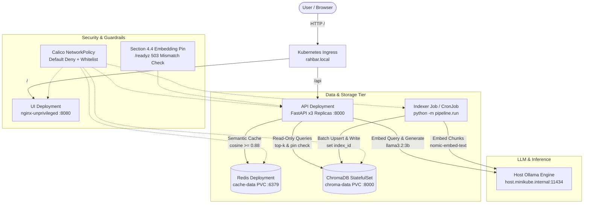

# RAHBAR: Grounded RAG on Kubernetes

[](https://github.com/Shayan-Tariq185/Rahbar-SCD/actions/workflows/ci.yml)
[](LICENSE)
[](https://kubernetes.io/)
[](https://www.python.org/)

**RAHBAR** is an enterprise-grade, grounded Question-Answering (RAG) system running on Kubernetes, specifically built to answer student queries from official FAST-NUCES academic regulations, course catalogs, and fee policies. The platform enforces strict factual grounding: answers cite exact source documents, sections, and page numbers, while deliberately abstaining when facts are absent. Architecturally, the system cleanly decouples offline batch indexing from online stateless serving: document extraction and vectorization run inside a Kubernetes **Job** and scheduled **CronJob** that populate a persistent ChromaDB vector store, while a high-availability **FastAPI Deployment** (3 replicas with HPA) handles question validation, Redis semantic caching, embedding-pin guardrail verification, dense vector retrieval, and schema-constrained LLM generation.

---

## Architecture



---

## HTTP API Specifications

| Method | Path | Auth | Description |
| :--- | :--- | :--- | :--- |
| GET | `/healthz` | None | Liveness probe: returns `{"status":"alive"}` without querying databases. |
| GET | `/readyz` | None | Readiness probe: 200 only if Redis ping, Chroma heartbeat, collection > 0, and embedding pin match. Else 503. |
| GET | `/metrics` | None | Prometheus metrics: request latencies, cache hit ratios, abstentions, and token counters. |
| POST | `/api/ask` | None | Primary Q&A endpoint: validates question, checks cache, retrieves top-$k$, and returns cited `Answer`. |

---

## Prerequisites

Before running RAHBAR, ensure the following tooling is installed on your workstation:
- **Docker Engine** (or Docker Desktop) $\ge 24.0$
- **Minikube** $\ge 1.33$ (with hypervisor / docker driver)
- **kubectl** $\ge 1.28$
- **Kustomize** $\ge 5.0$
- **Python 3.12** & `make`

---

## Clean Clone Deployment Workflow

Follow these exact numbered steps to bootstrap the entire cluster from a clean repository clone:

```bash
# 1. Clone the repository
git clone https://github.com/Shayan-Tariq185/Rahbar-SCD.git
cd Rahbar-SCD

# 2. Install local dependencies and virtualenv
make install

# 3. Start the Minikube cluster with Calico CNI and required addons
make cluster
# (Starts minikube with memory=6144, cpus=4, CNI=calico, addons: ingress, metrics-server)

# 4. Build local container images
make images
# (Builds rahbar-api:dev, rahbar-indexer:dev, and rahbar-ui:dev)

# 5. Apply the development Kubernetes manifests
kubectl apply -k k8s/overlays/dev

# 6. Configure Secrets (Only needed if using a hosted LLM provider)
# For local Ollama, this step is optional; if hosted, inject your key:
export LLM_API_KEY="your-api-key"
make secret

# 7. Configure DNS or Start Ingress Tunnel
# On Linux/macOS, map rahbar.local in /etc/hosts:
echo "$(minikube ip) rahbar.local" | sudo tee -a /etc/hosts
# On Windows (Docker Driver), run minikube tunnel in a separate terminal:
minikube tunnel

# 8. Run the batch indexing Job
make index
# (Executes the batch Indexer Job to extract, embed, and store document chunks in ChromaDB)

# 9. Verify deployment status
kubectl rollout status deployment/api -n rahbar
kubectl get pods -n rahbar

# 10. Ask a question through the Ingress
make ask Q="What is the minimum CGPA required to avoid academic warning?"
```

---

## Re-Indexing Operations (One-Command Trigger)

To trigger an on-demand re-index without redeploying the API or causing pod churn:

```bash
kubectl create job --from=cronjob/reindex manual-reindex-1 -n rahbar
kubectl wait --for=condition=complete job/manual-reindex-1 -n rahbar --timeout=180s
```

---

## Document Corpus & Ingestion

Raw university PDF files are deliberately **not committed to Git** to prevent repository bloat. Instead, the corpus is version-controlled via:
- `corpus/MANIFEST.md`: Cryptographic inventory of official documents, versions, URLs, and checksums.
- `corpus/fetch.py`: Automated retrieval script that downloads and validates raw PDFs locally.

To fetch the raw corpus:
```bash
python corpus/fetch.py
make images CORPUS_SRC=corpus/raw
```

---

## Embedding Host & Model Architecture

- **Embedding Model**: `nomic-embed-text` (768 dimensions, cosine distance).
- **LLM Generator**: `llama3.2:3b` hosted locally via Ollama.
- **Cluster Connectivity**: The cluster connects to the host machine at `host.minikube.internal:11434`.
- **Egress Security**: Our Calico NetworkPolicy (`k8s/base/networkpolicy.yaml`) strictly permits egress from `api` and `indexer` pods to the specific Ollama host IP while blocking all unauthorized external internet access.

---

## Secret Management Workflow

> [!CAUTION]
> **Zero Secrets in Git**: Never commit `.env` files, API keys, or raw base64 Secrets into version control (automatic −20 deduction).

Real secrets are injected via the CLI exclusively:
```bash
export LLM_API_KEY="sk-..."
make secret
```
The repository includes a template `k8s/base/secret.placeholder.yaml` with `REPLACE_ME` values that is **never** referenced in `kustomization.yaml`.

---

## Verification & Clean Clone Testing Commands

To verify that your environment satisfies all rubric requirements:

```bash
# Run all unit tests and offline test coverage
make test

# Run code formatters and static type analysis
make lint

# Validate Kubernetes manifests with Kubeconform
kustomize build k8s/overlays/prod | kubeconform -strict -ignore-missing-schemas -summary

# Execute the assignment submission checker
python scripts/check_submission.py
```

---

## Documentation Index

- [Architecture & StatefulSet Deep Dive](docs/ARCHITECTURE.md)
- [Document Corpus Specifications](docs/CORPUS.md)
- [Pipeline Chunking & Storage Amplification](docs/PIPELINE.md)
- [Failure Mode Analysis (Stages A–F)](docs/FAILURE-ANALYSIS.md)
- [Engineering Notes & Viva Defenses](docs/ENGINEERING-NOTES.md)
- [AI Tool Usage Transparency](docs/AI-USAGE.md)
- [Architecture Decision Records (ADRs)](docs/adr/)
  - [ADR 0001: Indexer as a Kubernetes Batch Job](docs/adr/0001-indexer-as-job.md)
  - [ADR 0002: Structure-Aware Document Chunking Strategy](docs/adr/0002-chunking-strategy.md)
  - [ADR 0003: Semantic Response Cache Store Architecture](docs/adr/0003-cache-store.md)
  - [ADR 0004: LLM Provider Architecture & PII Protection](docs/adr/0004-llm-provider-pii.md)
