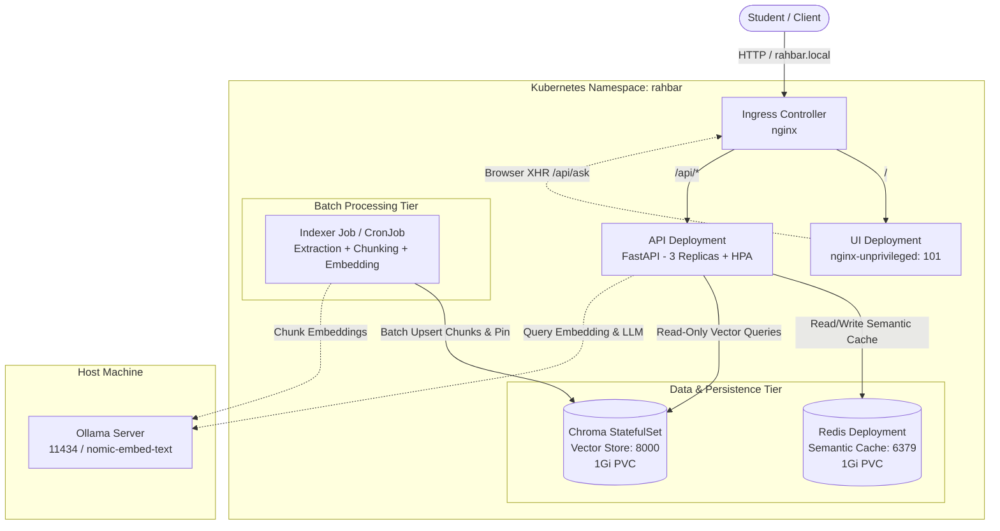

# RAHBAR: System Architecture & Deployment Blueprint

<!-- OUTLINE: System architecture document for RAHBAR: Grounded RAG on Kubernetes -->

## 1. Executive Overview
- **Purpose**: Production-grade, grounded retrieval-augmented generation (RAG) platform serving institutional regulatory queries on Kubernetes.
- **Key Architectural Pillars**:
  - *Tiered decoupling*: Stateless web and API tiers separate from persistent vector/cache storage and batch indexing.
  - *Least privilege security*: Deny-by-default Calico NetworkPolicy, non-root execution (UID 10001/101), read-only root filesystems, and tokenless service accounts.
  - *Reliability & Guardrails*: Sub-millisecond semantic caching, embedding-pin verification, and honest abstentions.

---

## 2. Component Topology & Data Flow

---

## 3. Deep-Dive: Why Chroma is a StatefulSet

<!-- OUTLINE: Key design rationale for choosing StatefulSet over Deployment for the vector database. -->

- **1. Stable Network Identity & Hostname**:
  - Chroma operates as a single-instance stateful vector storage engine using SQLite (metadata) and HNSW (vector indices).
  - StatefulSet guarantees predictable ordinal naming (`chroma-0`) and a persistent network DNS name (`chroma-0.chroma.rahbar.svc.cluster.local`), ensuring dependent services resolve the exact backend instance across restarts.

- **2. Dedicated PersistentVolumeClaim per Pod via `volumeClaimTemplates`**:
  - Deployments bind to a shared `PersistentVolumeClaim` definition, which on standard block-storage (EBS, GPD, Minikube HostPath) is formatted as `ReadWriteOnce` (RWO).
  - If a Deployment re-schedules or scales, multiple pods cannot safely mount the same RWO disk.
  - `volumeClaimTemplates` automatically provisions and binds an independent PVC (`chroma-data-chroma-0`) directly tied to the Pod ordinal, preventing volume attachment collisions.

- **3. Protection Against SQLite & Vector Index Corruption**:
  - Vector indices (HNSW) and Chroma's internal SQLite database are file-backed and require strict single-process write exclusivity.
  - A Deployment rolling update can start a second pod before the first pod terminates, leading to two processes attempting to lock and write to the same files concurrently, corrupting the database.
  - StatefulSet enforces ordered, controlled scale-down and scale-up, eliminating split-brain disk writes.

- **4. Graceful Shutdown & Buffer Flushing**:
  - StatefulSet termination sequence permits Chroma to flush in-memory vector index segments and WAL journals to disk cleanly before the pod is evicted.

---

## 4. Workload Tiering & Specifications

### 4.1 Stateless Service Tier
- **Web UI (`k8s/base/ui-deployment.yaml`)**:
  - Base: `nginxinc/nginx-unprivileged:1.27.4-alpine` (runs as UID 101, non-root).
  - Replicas: 1 (scalable as needed).
  - Port: 8080 (serves static HTML/JS/CSS).
- **API (`k8s/base/api-deployment.yaml`)**:
  - Base: `python:3.12.7-slim-bookworm` (FastAPI + Uvicorn, UID 10001).
  - Replicas: 3 (autoscaled by HPA from 3 to 8 pods based on 70% CPU threshold).
  - High Availability: `maxSurge: 1`, `maxUnavailable: 0`, and a `preStop` sleep hook (5s) for zero-downtime rolling updates.
  - Probes: Distinct liveness probe (`/healthz`, zero dependency touches) and readiness probe (`/readyz`, checks Redis, Chroma count > 0, and embedding pin).

### 4.2 Data & Cache Tier
- **Redis (`k8s/base/redis.yaml`)**:
  - Sub-millisecond vector semantic cache with 24h key TTL and `index_id` namespacing.
- **Chroma (`k8s/base/chroma-statefulset.yaml`)**:
  - Persistent vector store with 1Gi storage backing SQLite + HNSW.
  - Configured with `enableServiceLinks: false` to eliminate port-naming collision with Chroma's Rust runtime.

### 4.3 Batch Indexing Tier
- **Indexer Job (`k8s/base/indexer-job.yaml`)**:
  - Decoupled batch workload for corpus extraction, OCR, chunking, and embedding.
- **Reindex CronJob (`k8s/base/reindex-cronjob.yaml`)**:
  - Scheduled weekly run (`0 0 * * 0`) with `concurrencyPolicy: Forbid`.

---

## 5. Security & Zero-Trust Architecture

- **Deny-by-Default Calico NetworkPolicy (`k8s/base/networkpolicy.yaml`)**:
  - Default ingress and egress blocked across the entire `rahbar` namespace.
  - DNS egress strictly permitted to `kube-dns` on UDP/TCP port 53.
  - UI ingress permitted only from `ingress-nginx`.
  - API ingress permitted from `ingress-nginx` and `rahbar-ui`.
  - Chroma ingress permitted ONLY from `api` (read-only) and `indexer` (read/write).
  - Redis ingress permitted ONLY from `api`.
  - Egress to Ollama restricted to `host.minikube.internal:11434` (ipBlock CIDR).

- **Pod Security Hardening**:
  - All containers run as non-root (`runAsNonRoot: true`, UID 10001 / 101).
  - Linux capabilities completely dropped (`drop: ["ALL"]`).
  - Read-only root filesystem (`readOnlyRootFilesystem: true`), using mounted `emptyDir` on `/tmp` for writable scratch space.
  - Disabled ServiceAccount token mounting (`automountServiceAccountToken: false`).

---

## 6. Observability & Telemetry

- **Prometheus Metrics (`/metrics`)**:
  - `rahbar_requests_total`: Counter by route and status code.
  - `rahbar_retrieval_latency_seconds`: Histogram measuring vector search duration.
  - `rahbar_generation_latency_seconds`: Histogram measuring LLM generation duration.
  - `rahbar_cache_hits_total` & `rahbar_cache_misses_total`: Semantic cache performance tracking.
- **Structured JSON Logging**:
  - Single-line machine-readable JSON logs per query containing `ts`, `request_id`, `top_k`, chunk IDs, relevance scores, and cache hit flags.
  - Redaction: Full raw query text and secret headers are excluded.

